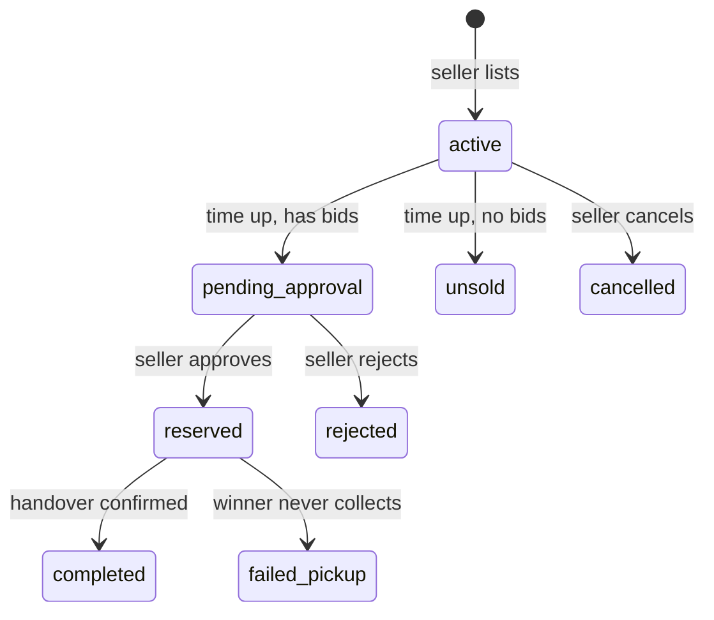
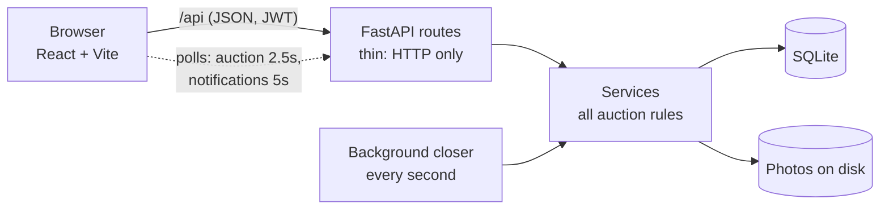

<div align="center">

# Relay

**Timed campus auctions: seniors pass things down, juniors win them fairly.**


</div>

> The repository and code are named **CampusBid**; the product is called **Relay**.

## Why

At the end of the semester, seniors leave behind cycles, calculators and books. Today those change hands through
fastest-finger chat messages at guessed prices. Relay turns every item into its own timed auction: students browse,
bid publicly, and the highest bid at closing wins, pending the seller's approval. Prices are fair, the history is
public, and only verified campus students can take part.

## Features

- **Campus-only accounts.** Only institutional `.edu` addresses on your campus domain can register, with year of study and department, a show/hide password toggle and password confirmation. They verify with a 6-digit code before listing or bidding.
- **Browse and search** open auctions by keyword, category, condition and price range, with "closing soon" and sorting. Filters live in the URL, so a view can be shared.
- **Live auction page.** Photos, current price and leader, a public bid history, and a countdown driven by the *server's* clock. Two browsers see each other's bids within seconds.
- **Automatic bidding.** Set a maximum and the app bids for you, only as much as needed to keep you in front, never past your limit. Maximums are public, ties go to whoever committed first, and automatic bids are marked in the history.
- **Last-minute extensions.** A bid in the final 30 seconds moves the closing time to 60 seconds after it, so nobody wins by sniping. It applies to automatic bids too, and the page shows the countdown jump and an "Extended" marker.
- **Fair bidding.** A bid must beat the price by the seller's minimum raise. You can't bid on your own item or against yourself. Two simultaneous bids can't both win. A late bid is impossible even if the closing job lags.
- **Selling.** List an item with 1-5 photos, edit it (only the description and photos once bidding starts, with a visible "Edited" marker), or cancel it.
- **Sale workflow.** When an auction ends with a winner, the seller approves or rejects; after approval they confirm the handover or record that the winner didn't collect.
- **Notifications.** A bell with an unread badge plus opt-in desktop pop-ups when the tab is in the background: outbid, new bid, you won, approved or rejected, cancelled.
- **My listings and My bids** pages that say, in plain words, what each auction means for you.

## How an auction works



## Architecture



All rules about money and time live in one place (`backend/app/services/`); routes only translate HTTP. The browser's
countdown is cosmetic: the server's clock alone decides whether a bid is on time.

| Layer | Technology |
|---|---|
| Backend | Python, FastAPI, SQLAlchemy 2, SQLite (WAL), JWT, scrypt |
| Frontend | React 19, Vite, React Router, TanStack Query (plain JavaScript) |
| Live updates | Polling (simple and robust; no websockets to keep alive) |
| Tests | pytest (backend), Vitest (frontend), plus real-browser runs with headless Chrome |

## Quick start

You need Python 3.11+ and Node 20+.

```bash
# 1. Backend: http://localhost:8000
cd backend
python3 -m venv .venv && .venv/bin/pip install -r requirements.txt
cp .env.example .env            # then set DEV_MODE=true and AUTO_VERIFY=true for local use
.venv/bin/python scripts/seed.py            # optional: demo users + 15 auctions
.venv/bin/uvicorn app.main:app --reload

# 2. Frontend (second terminal): http://localhost:5173
cd frontend
npm install
npm run dev
```

The browser calls the backend under `/api`; the Vite dev server proxies that to FastAPI
(`VITE_API_TARGET` overrides the default `http://localhost:8000`). In dev mode the interactive API docs are at
`http://localhost:8000/docs`.

## Demo

```bash
cd backend
.venv/bin/python scripts/seed.py            # 5 users + 15 auctions (refuses if already seeded or if DEV_MODE is off)
.venv/bin/python scripts/seed.py --reset    # wipe ALL data first, then seed
.venv/bin/python scripts/seed.py --clear    # wipe ALL data and stop: an empty app again
```

Seed right before presenting: one auction is set to close in about 90 seconds. Sign in as `<name>@campus.edu`
(or your domain via `--domain`) with password `password123`:

| User | Role | What they show |
|---|---|---|
| `arjun`, `meera` | final-year sellers | Arjun has a sale awaiting handover; Meera has a sale waiting for her decision |
| `priya`, `rahul`, `sneha` | bidders | Priya leads one auction and is outbid on another |

**Walkthrough:** browse and filter; open the 90-second auction as Priya in one window and bid as Rahul in another
(watch it update live); let it close; approve the sale as the seller and watch the winner's bell light up.

## Configuration

Set via environment variables or `backend/.env` (see `backend/.env.example`).

| Variable | Default | Meaning |
|---|---|---|
| `ALLOWED_EMAIL_DOMAINS` | *(required)* | Comma-separated campus domains; subdomains match. |
| `REQUIRED_EMAIL_SUFFIX` | `.edu` | Every registering address must end with this. Empty turns the check off. |
| `SECRET_KEY` | dev value | Signs login tokens. **Required to be long and random outside dev mode.** |
| `DEV_MODE` | `false` | Local/demo switch: skips the two requirements above, prints verification codes to the log, serves `/docs`. |
| `AUTO_VERIFY` | `false` | Mark new accounts verified immediately (skips the email step). |
| `DATABASE_URL` | `sqlite:///./campusbid.db` | Database location. |
| `CORS_ORIGINS` | localhost dev origins | Browser origins allowed to call the API directly. |
| `MAX_REQUEST_BYTES` | 30 MB | Larger requests are refused with 413. |
| `CLOSER_INTERVAL_SECONDS` | `1` | How often expired auctions are closed; `0` disables the closer. |

No email service is wired up yet, so verification codes only appear in the server log (dev mode).

## The rules

- **Money** is whole rupees (integers), ₹1 to ₹10,000,000. Never floats.
- **Automatic bidding.** A maximum can be set by anyone but the seller, at least the price they would have to beat (a leader only needs to cover their own price). After every bid the strongest maximum answers the current leader: a higher maximum takes the lead one step over the leader's ceiling, and a lower one makes the leader answer one step above it. Equal maximums go to the earlier commitment, and changing a maximum puts it at the back of that queue. Everything runs inside the same write lock, and every automatic bid obeys the normal increment rule.
- **A bid is valid** when the listing is open and before its closing time (server clock), the bidder isn't the seller, the bidder isn't already the highest bidder, and the amount is at least the starting price (first bid) or the current price plus the minimum raise.
- **Auction length** is 10 minutes to 30 days, plus extensions: a valid bid in the last 30 seconds moves the closing time to 60 seconds after that bid. Every bid goes through one function, so automatic bids extend too, and the closer re-checks the closing time under the same lock.
- **Races.** Bids, edits, cancels and sale decisions run under SQLite's write lock (`BEGIN IMMEDIATE`), so simultaneous requests are serialised and exactly one wins.
- **Closing.** A background task closes expired auctions every second; reads and bids also close an overdue auction first, so a late bid can't slip in. Each closing announces itself exactly once.
- **Editing.** Anything can change before the first bid; afterwards only the description and photos, and the page shows when it was edited.
- **Privacy.** The public bid history shows display names only, never emails.

## Security

| Area | What is done |
|---|---|
| Passwords | scrypt (N=2^15, r=8, p=3, the OWASP-recommended cost), unique salt per user, cost stored with each hash and upgraded automatically at login |
| Login | Same response and same work for wrong password and unknown email (no account enumeration by message or timing); rate limited per account and per IP |
| Tokens | Signed JWTs with the algorithm pinned, an expiry and subject required, 24 h lifetime |
| Startup | Refuses to start outside dev mode with a missing, short or placeholder `SECRET_KEY`, or without a campus domain list |
| Accounts | Exact-domain matching (`evilcampus.edu` and `campus.edu.evil.com` fail), `+tag` and case folding, 6-digit codes stored only as keyed hashes, expiry, attempt limit and resend cooldown |
| Authorisation | Every seller action checks ownership; notifications and "my" pages are scoped to the caller; tested for each endpoint |
| Uploads | Real file type sniffed from bytes (JPEG/PNG/WebP only), 5 MB per photo, random server-chosen file names, 30 MB request cap enforced before the body is read |
| Responses | `nosniff`, `X-Frame-Options: DENY`, no-referrer, strict CSP, `no-store` on API data, HSTS over HTTPS; no password data in any response |
| Abuse | Rate limits on login, registration, code checks, bidding, listing and uploads |
| Surface | Interactive API docs only in dev mode; CORS limited to configured origins; no raw SQL from user input |
| Dependencies | `pip-audit` and `npm audit` report no known vulnerabilities |

**Before deploying:** serve over HTTPS (tokens travel in headers), set a real `SECRET_KEY` and `ALLOWED_EMAIL_DOMAINS`,
turn `DEV_MODE` and `AUTO_VERIFY` off, wire up email delivery, and put the rate limiter behind a proxy that passes the
real client address.

**Known limits.** Registering reveals whether an email is already taken (rate limited). Login tokens live in the
browser's local storage and can't be revoked before they expire. Rate limits are in memory, so they reset on restart
and are per process. The database file is not encrypted at rest (use disk encryption). There is no admin role yet.

## Tests

```bash
cd backend  && .venv/bin/python -m pytest     # 287 tests: rules, races, automatic bidding, security, auth, notifications, seed
cd frontend && npm test                        # 66 tests: formatting, filters, forms, bid and sign-up logic
```

The concurrency tests prove the lock matters: one transaction holds the write lock while an edit or approval waits,
and the waiting action must then refuse because it sees the new state.

## Project layout

```
backend/
  app/
    api/routes/      thin HTTP layer: auth, listings, bids, sale, me, notifications
    services/        business rules: auction.py (bids, closing), listings.py, sale.py, notifications.py, accounts.py, closer.py
    core/            config, password/JWT security, rate limiting, security middleware
    models/ schemas/ database tables, and what the public may see
  scripts/           seed.py (demo data), dbpeek.py (read-only database viewer)
  tests/
frontend/src/
  pages/             Browse, ListingPage, Sell, EditListing, MyListings, MyBids, Login, Register, Verify
  components/        cards, bid panel, notification bell, photo picker, seller actions, countdown
  lib/ hooks/ api/   pure helpers (with tests), the shared one-second clock, the API client
```

## API overview

| Area | Endpoints |
|---|---|
| Accounts | `POST /auth/register`, `/auth/login`, `/auth/verify`, `/auth/resend-code`; `GET /me` |
| Listings | `GET/POST /listings`, `GET/PATCH /listings/{id}`, `POST /listings/{id}/cancel`, `POST/DELETE /listings/{id}/images` |
| Bids | `POST/GET /listings/{id}/bids` |
| Automatic bidding | `PUT/DELETE /listings/{id}/auto-bid`, `GET /listings/{id}/auto-bids` (public), `GET /me/auto-bids` |
| Sale | `POST /listings/{id}/approve`, `/reject`, `/handover`, `/pickup-failed` |
| Mine | `GET /me/listings`, `GET /me/bids` |
| Notifications | `GET /notifications` (`?since_id=` for polling), `POST /notifications/{id}/read`, `/notifications/read-all` |

## Looking at the database

The data is one SQLite file, `backend/campusbid.db`.

- **Quick overview:** `cd backend && .venv/bin/python scripts/dbpeek.py` (read-only, hides password hashes; `-n 20 listings` shows more rows).
- **VS Code:** open the file with the *SQLite Viewer* extension.
- **Your own queries:** `sqlite3 -header -column backend/campusbid.db "select id, title, status, current_price from listings"`.

The server writes through a journal file (`campusbid.db-wal`), so a viewer that opens only the `.db` file can miss the newest rows;
`sqlite3 backend/campusbid.db "PRAGMA wal_checkpoint(TRUNCATE)"` merges them. There are no migrations: on startup the app adds any
new columns to an existing database (it never drops or changes data). Renaming or retyping a column needs the file deleted.

## Not built yet

- Duplicate-listing protection (double-submit key, same-photo detection, open-listing cap)
- Admin role (suspend users, remove listings, audit log)
- Email delivery for verification codes
- Optional extras: saved wants, per-auction Q&A, an AI assistant
